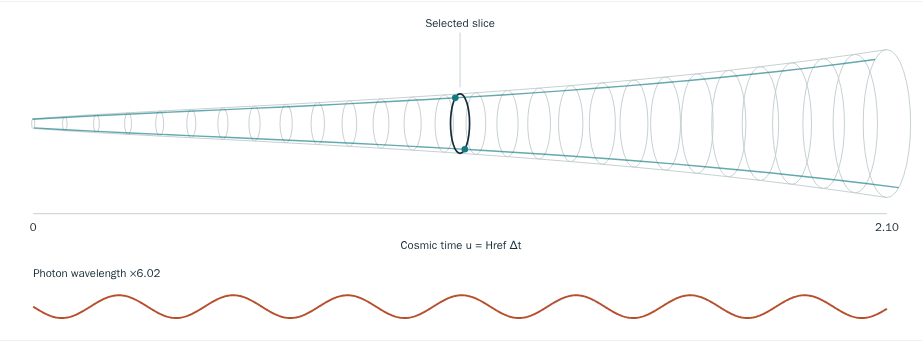
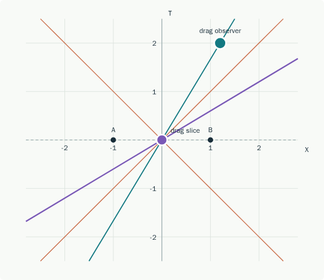

# Physinanigans · Universe Tunnel Lab

**What if a universe looked like a tunnel?** Three spatial dimensions, a sequence of time slices, and extra visual layers for the information a picture of space cannot show.

This is Victor's fun thought experiment, developed into an educational JavaScript lab. The picture is imaginative; each implemented calculation uses a stated physical model. You can drag through quantum histories, change a universe's ingredients, and tilt an observer's definition of “now.”


## Try it

The site is live at <https://mklolbullen.github.io/physinanigans/>. To use it offline, download or clone the repository, then open **`index.html`** in a modern browser. Keep the folder together. The committed pages work offline without installation, an account, a server or runtime network requests. A browser with native MathML support displays the rendered equations; expandable LaTeX source is also included.

Alternatively, run `python3 -m http.server 8000` here and visit <http://localhost:8000>.

| Experiment | Drag or change | What is calculated |
|---|---|---|
| `wavepacket.html` | Change time, width, momentum, mass and initial position | Exact free Gaussian wavepacket evolution: probability density, complex amplitude, center and spreading |
| `quantum.html` | Drag the time slice; change the initial state, coupling, dephasing or clock | Analytic two-qubit exchange plus Lindblad dephasing; SR and static Schwarzschild clock comparisons |
| `expansion.html` | Drag cosmic time; vary matter, radiation and Λ | Adaptive FLRW evolution, including recollapse, density scaling, test-photon redshift and linear growth of a matter overdensity |
| `scattering.html` | Choose a potential; set barrier height/width, wave number and packet width | Crank–Nicolson time-dependent Schrödinger evolution with optional absorbing boundaries |
| `relativity.html` | Drag the observer or simultaneity slice | Lorentz transformations, relative simultaneity and invariant intervals |
| `guide.html` | Expand an equation's LaTeX source | Plain-language connections to the Standard Model, GR and state spaces |

Every draggable has a native slider for keyboard use. There is no required animation or autoplay.

| Expansion: a growing universe with a stretching photon | Relativity: a boosted observer's slice of “now” |
|---|---|
|  |  |

## The idea in one equation

A schematic record of a slice, within a suitable classical-geometry/quantum-matter approximation, is

$$
\mathcal U_t=(\Sigma_t,h_{ij},K_{ij},\rho_t),\qquad\mathcal T=\{\mathcal U_t:t\in I\}.
$$

Here $\Sigma_t$ is three-dimensional space at a chosen time label, $h_{ij}$ its spatial geometry, $K_{ij}$ its extrinsic curvature and $\rho_t$ the retained quantum state. This is a way to organize data; equations of motion and constraints still have to be supplied. Classical field models store field values and conjugate momenta instead. A global stack of slices needs suitable spacetime assumptions.

The wall shows selected observables. Interior lines show relationships such as entanglement. The interior is not extra physical space or a signal channel. “More dimensions” means more independent state information, not additional directions in the room. The relativity experiment shows explicitly that a chosen stack of slices is not a universal present.

## New: linear growth of structure

A smooth universe cannot make a cosmic web. The expansion lab now carries one small, pressureless matter overdensity δ on the evolving background and integrates

$$
\ddot\delta+2H\dot\delta=\tfrac32 H_{\mathrm{ref}}^2\,\frac{\Omega_m}{a^3}\,\delta
$$

in the same adaptive step as a(t). The slice readout shows the growth factor and the growth rate f = d ln δ / d ln a: exactly 1 under matter domination, falling toward 0 once Λ takes over, and undefined at a recollapse turnaround. Checks compare against closed forms in the four single-component universes, an independent DOP853 integration, and the Ωₘ(a)^0.55 fit of Linder (2005). It is a single linear amplitude per slice, not a spatial field; see [COSMOLOGY.md](COSMOLOGY.md).

## New: Gaussian wavepacket laboratory

Open [**wavepacket.html**](wavepacket.html) to visualize the exact free-particle solution of the one-dimensional Schrödinger equation. Its controls modify initial position, width, mean momentum and mass; a time slider shows dispersion and group motion. This uses dimensionless units with ℏ = 1 and a fixed viewport. It is **not** a generic potential solver, field theory or gravitational model.

Run the two independent checks with `node --test tests/wavepacket.test.cjs` and `python3 -m unittest -v test_wavepacket`.

## New: 1D quantum scattering (numerical)

Open **[scattering.html](scattering.html)** for a numerical, interactive counterpart to the analytic [Gaussian packet](wavepacket.html). It evolves the time-dependent 1D Schrödinger equation with a *real time-independent potential* using a tridiagonal **Crank–Nicolson** integrator and complex arithmetic, with `ℏ = m = 1` in the UI.

Try free propagation, a rectangular barrier, a well or two barriers. Controls set potential height/width, initial wave number and wavepacket width; plot probability density alongside the potential.

**Interpretation:** density beyond a barrier is evidence of propagation into/through it but the instantaneous left/right probability readouts are **not** converged scattering coefficients. The computational interval has reflecting Dirichlet walls, so stop before boundary echoes return. Norm conservation is a check of the discrete unitary update, not a proof of continuum accuracy. There are no absorbing boundary conditions or multi-particle effects.

Run `node --test tests/schrodinger.test.cjs` to verify normalization, approximate free-packet group velocity, boundary behavior and input validation.

### Numerical validation and open boundaries

The scattering laboratory now supports an **optional quartic complex absorbing potential** near both edges. The sink changes the Hamiltonian to a non-Hermitian operator in the absorbing strips: total probability remaining on the grid decreases, while `norm + absorbedLeft + absorbedRight` should remain approximately one. A weighted sink calculation attributes absorbed norm to each side; these values are **not automatically reflection/transmission coefficients**.

The measured left/right probabilities also include any incoming packet still on the original side, and interaction-region probability is monitored separately. To estimate asymptotic reflection and transmission, let the outgoing packets separate from the interaction region and confirm that absorber contamination and wall reflections are negligible. No automatic claim of convergence for these observables is made.

Run `node --test tests/scattering-validation.test.cjs` to test the probability budget and compare free propagation on two grids against the analytic Gaussian. Norm conservation alone does not demonstrate accuracy: reducing `dx` and `dt` should reduce the numerical error.

## Three experiments worth trying

1. **Same probabilities, different states.** In the quantum lab, compare the entangled and unentangled 50/50 initial states. Both show equal local excitation probabilities. Only one has nonzero concurrence. Add dephasing to watch that distinction fade.
2. **A universe that turns around.** Choose “Closed universe · recollapse” in Expansion. Drag past the widest slice and follow contraction. A sufficiently late photon can become more energetic than it was at emission.
3. **Watch Λ switch structure growth off.** In Expansion, pick “Matter only”: the growth rate f stays at 1.000 while the overdensity grows in step with a. Switch to the mixed preset and drag toward late times; f sinks below 0.1 as the cosmological constant dilutes matter faster than gravity can gather it.
4. **Change who calls two events simultaneous.** In Relativity, set velocity to zero, then drag the observer to β=0.6. Events A and B keep their locations in the original diagram but acquire moving-frame times +0.75 and −0.75.

These are four scoped demonstrations. The qubit exchange coupling is not arbitrarily changed by cosmic expansion. Full Standard Model interactions, nonlinear structure formation and quantum gravity are described as extensions, not claimed as implemented.

## Mathematics and reading

- [Field notes](guide.html) — the plain-language guide; open it in a browser.
- [MODEL.md](MODEL.md) — quantum dynamics, assumptions, state-space architecture and sources.
- [COSMOLOGY.md](COSMOLOGY.md) — Friedmann equations, units, redshift, linear growth and numerical method.
- [RELATIVITY.md](RELATIVITY.md) — Lorentz transformations and the draggable coordinate diagram.
- [LaTeX document](docs/tunnel-notes.tex) — self-contained mathematical notes; compile with `pdflatex tunnel-notes.tex` in `docs/`.
- [ROADMAP.md](ROADMAP.md) — where electromagnetism, strong/weak interactions, structure and other layers could fit.
- [VALIDATION.md](VALIDATION.md) — what was checked and what the checks establish.

The sources are primary physics papers and teaching material from their authors or institutions. They establish the ingredients, not a novelty claim for this metaphor.

## Develop and verify

Prerequisites: Python 3.10+ and Node.js 20+. To rebuild the pages and rendered mathematics:

```sh
npm ci
npm run build
```

LaTeX is converted at build time by pinned KaTeX into native MathML. The browser does not fetch a math library, fonts or a CDN. Edit templates and engines, then rebuild; the generated HTML is committed so readers can open it immediately.

```sh
python3 -m pip install -r requirements-test.txt
npm run test:physics
npm test
npx playwright install chromium
npm run test:ui
```

The physics suite compares quantum evolution with an independent full Lindblad matrix exponential, cosmology with analytic solutions and SciPy integration, and JavaScript results with Python reference engines. The SR tests check invariants and inverse boosts. The Chromium test opens local files, exercises real mouse/touch/keyboard controls, checks narrow layouts, equation rendering and absence of network requests.

## Project layout

```text
model.js / model.py             quantum engines
cosmology.js / cosmology.py     FLRW engines with linear growth
wavepacket.js / schrodinger.js  analytic Gaussian packet and Crank–Nicolson solver
relativity.js                  pure Lorentz-transform functions
assets/drag.js                 pointer interaction helper
*-fragment.template.html       quantum and cosmology UI sources
templates/                     page sources and relativity UI
assets/                        CSS, original SVG illustration and screenshots
build.py                       page assembly
scripts/render-math.cjs         LaTeX → MathML
tests/ and test_*.py/.cjs       numerical and UI checks
docs/tunnel-notes.tex           printable mathematical source
```

See [CONTRIBUTING.md](CONTRIBUTING.md) before adding a physical layer. The static pages can be served by any ordinary static host. A GitHub Actions workflow (`.github/workflows/pages.yml`) publishes the committed pages to GitHub Pages on every push to `main`, after confirming they match their sources.

## Credit and reuse

Concept: Victor. Code and explanatory draft developed with AI assistance. Corrections, clearer explanations and independent validation are welcome. No claim of a new complete physical theory or of priority for the visualization is made. Code, text and the original diagram are available under the [MIT license](LICENSE); third-party build dependencies retain their own licenses.
